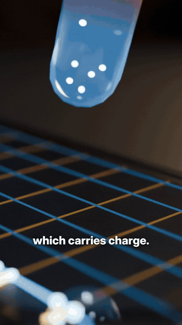

# Stick Fleet

Stick Fleet makes short explainer videos (Instagram Reels) from start to finish. It writes the script, voices it, films it in
Blender, adds the captions and posts the finished Reel. A Claude Code chat runs it: Claude does the writing and the looking at
frames, and code does the rest.

## Examples

[](https://www.instagram.com/reel/DfsPWF_Byhp/)

*Eight seconds of "How does a touch screen work?". Click the clip to watch the whole Reel with sound.*

More on Instagram at **[@cavemanfilms.tv](https://www.instagram.com/cavemanfilms.tv/)**:

- [How does a touch screen work?](https://www.instagram.com/reel/DfsPWF_Byhp/)
- [How to be a fighter jet](https://www.instagram.com/reel/Df-I4bqzI03/)
- [Why can't you put a fork in a microwave?](https://www.instagram.com/reel/Df00BO6Jp9q/)
- [Why does strategy sometimes matter more than strength?](https://www.instagram.com/reel/Dfuq_S1JvV3/)
- [Why doesn't a woodpecker get a concussion?](https://www.instagram.com/reel/Dfko4CAJcpG/)

## How a short is made

1. **Idea.** Agents research real subjects and check every claim at its source. The owner says yes to an idea before anything
   is written.
2. **Script.** Claude writes it, and fresh agents review it and check how each line leads into the next.
3. **Voice.** ElevenLabs reads the script, and the picture is timed to each spoken word.
4. **Film.** Blender (Cycles) renders the shots: a scanned human, real sets and props from free asset libraries, and effects.
   Before anything is rendered, every frame is measured so nothing passes through anything else.
5. **Review.** A quick draft goes to a panel of reviewer agents (physics, looks, words, joins). Their findings are fixed, then
   the film is rendered once.
6. **Finish and post.** Remotion adds the captions and tags. The Reel is posted through Instagram's API, only on the owner's
   word.

Everything a film builds or downloads is kept in `data/library/` so later films can reuse it.

## Docs

- [BUILD.md](BUILD.md): what's built, how each part works and what's next
- [SHORTS.md](SHORTS.md): the shorts line, with Blender machine shorts and 2D systems shorts
- [CHARACTERS.md](CHARACTERS.md): the 3D character shorts

## Running it

```
uv run python run.py serve       # the engine, and MCP for Claude Code at http://localhost:8000/mcp
uv run pytest -q                 # the tests
```

Then, in Claude Code in this folder, run `/mcp` to connect.
